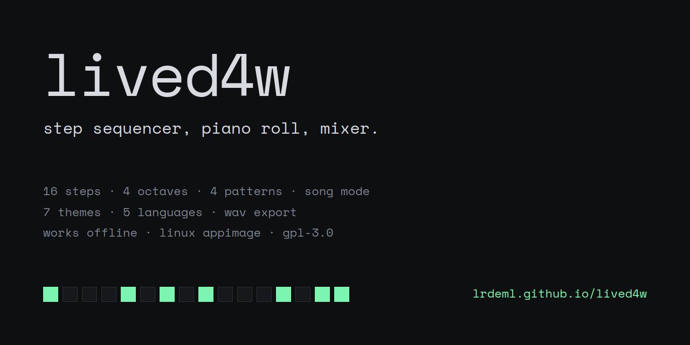

A small music studio that runs in the browser and as a Linux AppImage. Step sequencer, piano roll, mixer and song mode. All sounds are synthesized, so there are no samples to load and nothing to install for the web version.

**Web:** https://lrdeml.github.io/lived4w/
**Linux:** download the AppImage from [Releases](https://github.com/lrdeml/lived4w/releases)

## Features

**Sequencing**
- 16-step channel rack: Kick, Snare, Clap, Hat, Bass, Lead
- Piano roll for Lead, C2 to C6, with a piano key column (click a key to hear it)
- Play the Lead from your computer keyboard and record notes into the roll
- 4 patterns and an 8-slot playlist (song mode)
- Drum presets: Four on the floor, Hip-hop, Trap, Breakbeat
- Randomize, duplicate and clear pattern
- BPM 40 to 300, tap tempo, metronome

**Mixing**
- Volume and pan per channel, master volume, level meter
- Mute and solo
- Swing and delay

**Projects**
- Undo and redo (60 steps)
- Autosave, the last session is restored on start
- Save and open `.l4w.json` files, or drop a file onto the window
- Export the song as WAV
- Share a project as a single link

**Interface**
- 7 themes: Mint, plus six Material 3 palettes (Purple, Blue, Green, Teal, Red, Amber), each in light and dark, or follow the system
- 5 languages: English, Türkçe, Deutsch, Español, Français
- Works offline and can be installed as an app from the browser

## Controls

| Input | Action |
|---|---|
| `Space` | Play / stop |
| `Ctrl+S` / `Ctrl+O` | Save / open project |
| `Ctrl+Z` / `Ctrl+Y` | Undo / redo |
| `A W S E D F T G Y H U J K O L` | Play notes (Lead) |
| `Z` / `X` | Octave down / up |
| Click a channel name | Mute |
| `Shift` + click a channel name | Solo |
| Double-click a pan slider | Center it |
| Piano roll: click / drag | Add or remove a note / lengthen it |

## Linux

```bash
chmod +x lived4w-*-x86_64.AppImage
./lived4w-*-x86_64.AppImage
```

The AppImage is x86_64 only and needs a glibc-based distro (glibc 2.28 or newer, check with `ldd --version`), X11 or Wayland, and a sound server (PipeWire, PulseAudio or ALSA). If it does not start, install the libraries below.

| Distro | Command |
|---|---|
| Ubuntu 22.04, Debian 12, Mint | `sudo apt install libfuse2 libgtk-3-0 libnss3 libasound2 libgbm1 libxss1 libxtst6 libatspi2.0-0 libxkbcommon0` |
| Ubuntu 24.04+ | `sudo apt install libfuse2t64 libgtk-3-0t64 libnss3 libasound2t64 libgbm1 libxss1 libxtst6 libatspi2.0-0t64 libxkbcommon0` |
| Fedora, RHEL, Alma, Rocky | `sudo dnf install fuse-libs gtk3 nss alsa-lib mesa-libgbm libXScrnSaver libXtst at-spi2-core libxkbcommon` |
| Arch, Manjaro, EndeavourOS | `sudo pacman -S fuse2 gtk3 nss alsa-lib mesa libxss libxtst at-spi2-core libxkbcommon` |
| openSUSE | `sudo zypper install libfuse2 libgtk-3-0 mozilla-nss libasound2 libgbm1 libXss1 libXtst6 at-spi2-core libxkbcommon0` |
| NixOS | `nix-shell -p appimage-run --run "appimage-run lived4w-1.1.0-x86_64.AppImage"` |

These package names are from memory and may differ between releases. If one is not found, search for it with your package manager.

- **No FUSE:** skip `libfuse2` and run `./lived4w-*.AppImage --appimage-extract-and-run`.
- **Alpine and other musl distros** are not supported, the AppImage needs glibc.
- **No sound on PipeWire:** make sure `pipewire-pulse` is installed.
- **Sandbox errors:** the AppImage already starts with `--no-sandbox`, nothing to do.

## Build

Needs Node.js 18 or newer.

```bash
npm install
npm start
npm run dist
```

`npm start` runs from source. `npm run dist` writes `dist/lived4w-<version>-x86_64.AppImage`.

The whole app is one file, `docs/index.html`. The same file runs in the browser (GitHub Pages) and inside Electron, where the window buttons are drawn by the app itself.

```
docs/index.html            the app
docs/sw.js, manifest.*     offline support and install metadata
electron/main.js           window, single instance, crash recovery
electron/preload.js        window buttons
build/icon.png             app icon
```

## Not included

Loading your own samples, VST or plugin support, MIDI input, automation, reverb. Patterns are 16 steps long (one bar).

## License

GNU General Public License v3.0 only (`GPL-3.0-only`). See [LICENSE](LICENSE).
